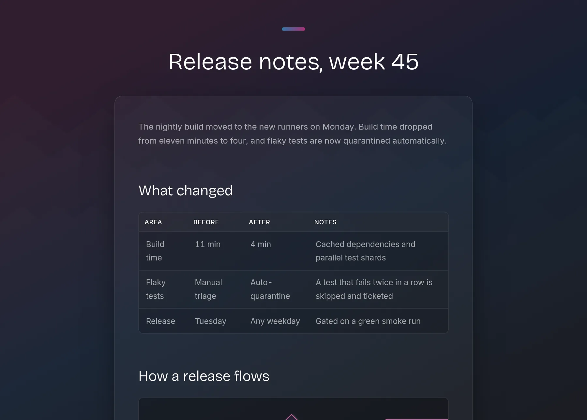
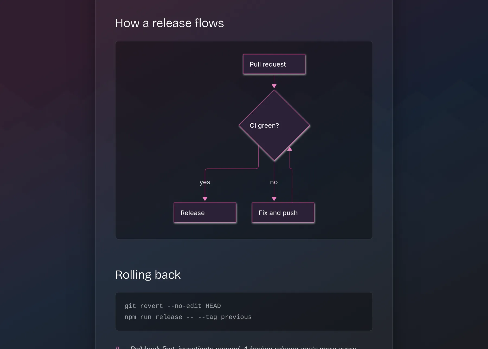
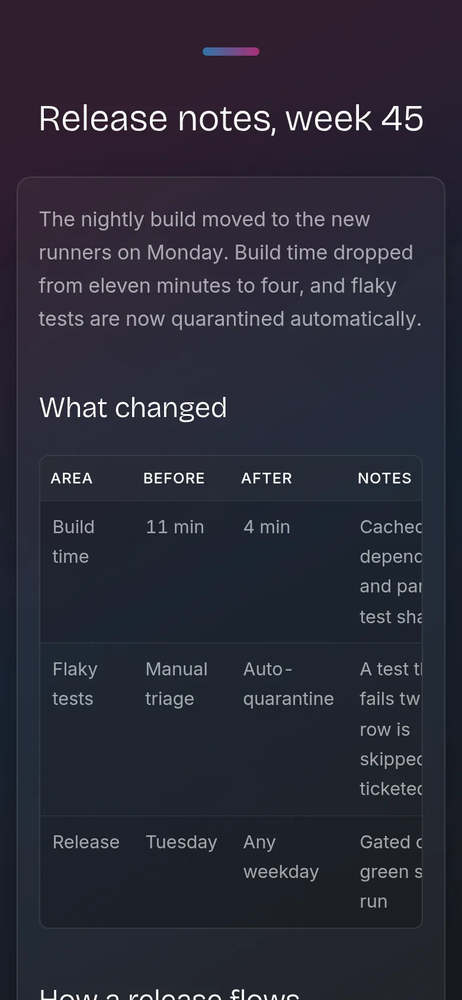
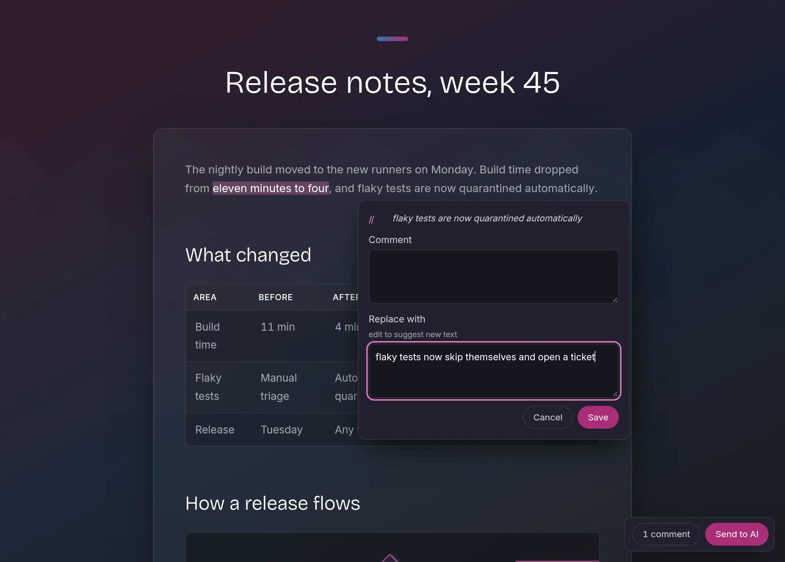

# justmd

Render markdown to a **self-contained HTML file** — GitHub-flavored tables, mermaid
diagrams, syntax-highlighted code, one opinionated dark theme. No network needed at
view time; the output travels anywhere (phone, chat attachment, air-gapped machine).



## Usage

```sh
npx justmd <file.md>              # write <file>.html, print its path
npx justmd <file.md> -o out.html  # choose output path
npx justmd <file.md> --open       # also open in the default browser
npx justmd <file.md> --review     # open with select-to-comment, comments go back to file
```

## Why

Every existing markdown viewer either needs a vault (Obsidian), renders tables
wrong (several Qt/GTK apps), or requires network for diagrams. `justmd` does one
thing: markdown in, a single portable HTML file out, using the same md4c parser
family the big renderers use.

- **Self-contained**: mermaid.js is inlined (~3.5 MB); zero external references.
- **Syntax highlighting** for fenced code blocks, baked in at render time (no
  client JS, no CDN) with a Tokyo Night palette.
- **GFM tables** with prose-friendly cells (horizontal scroll instead of squeeze).
- **Mermaid diagrams** render client-side, full-size (`useMaxWidth: false`).
- **Agent-friendly**: deterministic absolute output path on stdout, no side
  effects beyond the output file (plus the comments file in review mode). See
  [SKILL.md](SKILL.md) for the agent contract.

<p>


</p>

## Review mode

`--review` is for reviewing a draft with an AI agent without switching windows.
It serves the page on `127.0.0.1` and opens it. Select any text and a comment
button appears: write a comment, edit the text into what you want instead, or
both. Commented passages stay highlighted, and the list sits in the corner.



Every save is written to `<file>.comments.md` next to the input, with the quoted
passage, its source line, and your comment or replacement text. **Send to AI**
writes the final list and exits the process, so an agent that started
`justmd --review` and waits on it gets your comments the moment you press it.
The written `.html` file never contains the review UI.

## Desktop integration (Linux)

Make it the default handler for double-clicking `.md` files:

```sh
cat > ~/.local/share/applications/justmd.desktop <<DESK
[Desktop Entry]
Type=Application
Name=justmd
Exec=sh -c 'npx -y justmd "%f" --open'
Terminal=false
MimeType=text/markdown;text/x-markdown;
DESK
update-desktop-database ~/.local/share/applications
xdg-mime default justmd.desktop text/markdown
```

## Theme

A dark card over a fixed gradient with a parallax mountain backdrop, magenta
accents, and the Inter/Bricolage Grotesque pair embedded as base64 woff2 (so
type renders identically everywhere, with no network at view time). Body copy
is capped at a `72ch` measure for readability.

Readable on a phone out of the box: viewport meta, no text below 1rem, container
queries so the card scales to its own width rather than the screen, scroll fades
on wide tables and code blocks, and `prefers-reduced-motion` /
`prefers-contrast` support.

One theme, no configuration. Fork it if you want different colors; the palette
is CSS variables at the top of the template.

## License

MIT
