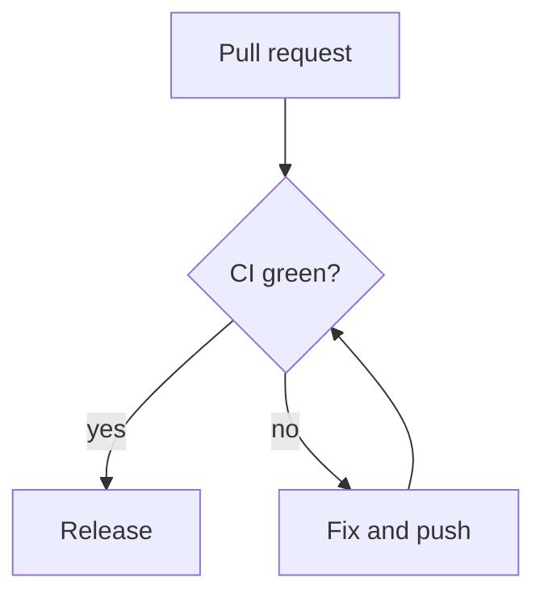

# Release notes, week 45

The nightly build moved to the new runners on Monday. Build time dropped from
eleven minutes to four, and flaky tests are now quarantined automatically.

## What changed

| Area | Before | After | Notes |
|---|---|---|---|
| Build time | 11 min | 4 min | Cached dependencies and parallel test shards |
| Flaky tests | Manual triage | Auto-quarantine | A test that fails twice in a row is skipped and ticketed |
| Release | Tuesday | Any weekday | Gated on a green smoke run |

## How a release flows



## Rolling back

```sh
git revert --no-edit HEAD
npm run release -- --tag previous
```

> Roll back first, investigate second. A broken release costs more every
> minute it stays live.
